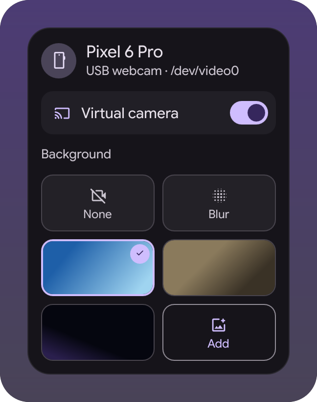
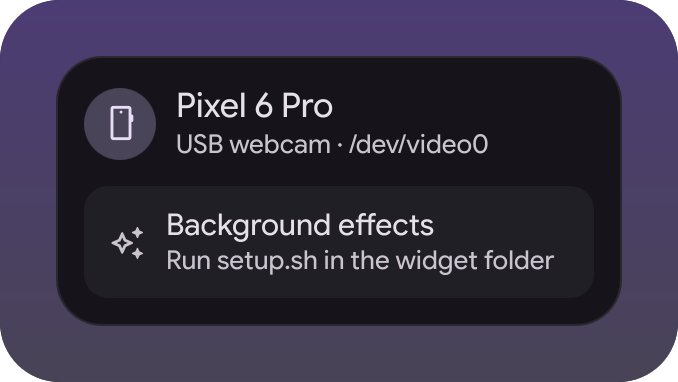

# Android webcam widget

An icon in the bar while a phone is plugged in as a USB webcam, and a popup with
which phone it is and which `/dev/video*` node it took. It can do the switching
too: a phone visible over adb is put in UVC mode, instead of typing that on
every plug. A widget for the
[illogical-impulse extensions fork](https://github.com/Berupor/dots-hyprland-extensions).

With OpenEffects set up, the same icon fronts a virtual camera: the click starts
and stops it, the popup swaps the background between raw, blurred and a picture.
Without it the popup says so in one line and stays an indicator.

| In the bar | The popup | Without the effects |
|---|---|---|
|  |  |  |

No phone was plugged in for the pictures: the scenes in `demo/` hand the views
made-up video nodes, which is how the tests run too.

## Install

Settings → Widgets → Install a widget, paste:

```
https://github.com/Berupor/ii-widget-android-webcam.git
```

Detection needs nothing installed. The kernel names such a node
`<model>: Android Webcam` and that is all the widget looks for, so a phone you
switched over yourself shows up the same way.

Switching needs `adb` (`android-tools`) and a phone that trusts this computer; it
runs `svc usb setFunctions uvc` there. Off by default, since it takes over the
phone's USB mode. Its options are which phone (any adb device, or one by model),
how often to look, and whether to say a word when it happens. Android refuses
on a locked screen, and firmware without a webcam mode drops USB on the command
and comes back adb-only, so a phone is tried three times and then left alone until
it is unplugged for three polls in a row. One phone at a time: while one is a webcam,
the others are not switched.

## Virtual camera

Optional, and not in the widget's `dependencies` on purpose: a missing
[OpenEffects](https://github.com/funinkina/openeffects) costs the effects, not
the widget. The popup draws its effects half once `openeffectsctl`,
`openeffectsd` and `openeffects-v4l2.service` are all there, and names what is
missing until then. It looks again every five seconds, so the switch appears by
itself after `setup.sh` runs. The `Background effects through OpenEffects` option
hides that half for good.

OpenEffects ships the daemon, the CLI and a GTK control surface as three packages
on its releases page; the widget needs the first two and drives everything
through `openeffectsctl`. Then run `./setup.sh` once: it links
`systemd/openeffects-v4l2.service` and `wireplumber/51-android-webcam.conf` into
place, makes the folders, and removes an `obs-vcam.service` link if one exists.

openeffectsd publishes a PipeWire node and nothing else, so the unit bridges that
node into `/dev/video10` with one `gst-launch` line, for everything that wants a
v4l2 device. The bridge is also the daemon's only consumer: the phone is opened
when the unit starts and released when it stops, which is why the unit alone is
the switch. `v4l2loopback` has to provide that node: `setup.sh` prints the root
commands it needs and exits 1 while the node is missing, and the popup says so.

The WirePlumber rule keeps the raw phone out of the PipeWire graph. With its node
in there, WirePlumber links every camera to the bridge, PipeWire opens
`/dev/video*` first about half the time, and openeffectsd then fails with
`Device is busy` and quietly publishes a 640x360 test pattern instead. Apps get
the phone through `/dev/video10`.

The switch in the popup, and a click on the bar icon, start and stop the unit.
Backgrounds are one grid: `None` is the raw feed, `Blur` the daemon's portrait
blur, and every other cell a picture from `backgroundDir`
(`~/Pictures/webcam-backgrounds` by default, `.jpg`, `.jpeg`, `.png`, `.webp`).
`Add` opens `kdialog` or `zenity`, whichever is around, else just the folder, and
copies what you pick into it. Picking a cell is one `openeffectsctl background`
call. Unplugging the phone stops the unit whatever started it, since what it
published had no other source. `autoStart` is the other direction: the unit comes
up by itself once a phone attaches.

What the popup shows is the daemon's own state, seeded from `openeffectsctl
effects` and then followed over `openeffectsctl watch`, so the OpenEffects GUI
and the popup cannot disagree about the camera.

The gesture reactions openeffectsd also has are deliberately not wired in. A
thumbs-up held for ten seconds fired nothing, a thumbs-down fired waving-hand
sprites, a two-hand heart fired thumbs-up ones, and emoji were on screen for 35
seconds out of 60. The effect has one parameter, `enabled`, so there is nothing
to tune from here.

## Hacking

With the fork checked out next door, the scenes are both the tests and the pictures:

```sh
tests/qml-cases.sh    -x ~/.config/illogical-impulse/widgets/androidWebcam
tests/widget-shots.sh -x ~/.config/illogical-impulse/widgets/androidWebcam
```

`git config core.hooksPath .githooks` runs them on push. GPL-3.0.
